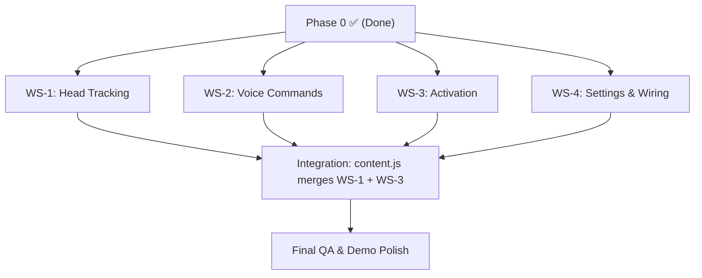

# Handsfree — Parallel Implementation Plan

> **Purpose:** This plan divides all remaining work into **4 independent workstreams** so 4 teammates can develop simultaneously without stepping on each other's code.

> [!IMPORTANT]
> **Read this before writing any code.**
> - Phase 0 (scaffolding + popup UI) is already complete.
> - The popup UI (`src/popup/App.jsx`) is polished and uses **Tailwind CSS v4** via `@tailwindcss/vite`. Do NOT add `postcss.config.js` or `tailwind.config.js`.
> - All inter-script communication uses the `MSG` constants from [`src/shared/messages.js`](src/shared/messages.js). Add new message types there if needed — never hardcode message strings.
> - The build system is `vite.config.js` with `@crxjs/vite-plugin` + `@tailwindcss/vite` + `@vitejs/plugin-react`. Do NOT change this.

---

## Current State (What's Done)

| Component | Status | Key Files |
|---|---|---|
| Vite + React + CRXJS scaffold | ✅ Complete | `package.json`, `vite.config.js` |
| Manifest V3 | ✅ Complete | `src/manifest.json` |
| Popup UI (3 tabs) | ✅ Complete | `src/popup/App.jsx`, `src/popup/styles.css` |
| Background worker (relay) | ✅ Complete | `src/background/background.js` |
| Content script (skeleton) | ✅ Skeleton | `src/content/content.js` |
| Message protocol | ✅ Complete | `src/shared/messages.js` |
| `.gitignore` | ✅ Fixed | `.gitignore` (UTF-8, excludes `node_modules/`, `dist/`) |

---

## Workstream Overview

```
┌─────────────────────────────────────────────────────────────────────┐
│                     SHARED INTERFACE LAYER                         │
│                                                                     │
│  src/shared/messages.js     — MSG constants (add new types here)    │
│  src/shared/constants.js    — Default config values                 │
│  src/background/background.js — Message relay (popup ↔ content)    │
│  src/popup/App.jsx          — UI (owned by WS-4 for wiring)       │
└──────────────┬───────────┬──────────────┬──────────────┬────────────┘
               │           │              │              │
      ┌────────▼───┐ ┌─────▼──────┐ ┌────▼───────┐ ┌───▼────────────┐
      │   WS-1     │ │   WS-2     │ │   WS-3     │ │   WS-4         │
      │ Head Track │ │ Voice Cmd  │ │ Activation │ │ Integration &  │
      │ & Cursor   │ │ & Dictation│ │ & Targets  │ │ Settings & UI  │
      └────────────┘ └────────────┘ └────────────┘ └────────────────┘
```

---

## Workstream 1 — Head Tracking & Virtual Cursor

**Owner:** Aditya
**Branch:** `Aditya`
**Estimated time:** 6–8 hours

### Owned Files (create these)

| File | Purpose |
|---|---|
| `src/content/cursor/faceTracking.js` | Initialize MediaPipe `FaceLandmarker`, manage webcam start/stop, run detection per frame, emit landmark data |
| `src/content/cursor/cursorMath.js` | Pure functions: `calibrate()`, `applyDeadZone()`, `applySmoothing()`, `mapToViewport()`, `clamp()` |
| `src/content/cursor/cursorController.js` | Orchestrator: owns the cursor DOM element, calls faceTracking + cursorMath on each `requestAnimationFrame`, updates position |
| `src/content/styles/overlay.css` | CSS for `#handsfree-cursor` (fixed-position, `pointer-events: none`, z-index max) |

### Modifies (carefully)

| File | What to change |
|---|---|
| `src/content/content.js` | Import `CursorController`, handle `MSG.START_TRACKING`, `MSG.STOP_TRACKING`, `MSG.PAUSE_CURSOR`, `MSG.RESUME_CURSOR`, `MSG.CALIBRATE` |

### Dependencies to Install

```bash
npm install @mediapipe/tasks-vision
```

### Implementation Steps

1. **Cursor Overlay CSS** — Create `overlay.css` with a fixed-position glowing dot (`#handsfree-cursor`), classes `.active` and `.paused`.
2. **`faceTracking.js`** — Initialize `FaceLandmarker` from `@mediapipe/tasks-vision`. Create `start()` (request webcam via `getUserMedia`, start detection loop) and `stop()` (stop camera tracks, destroy landmarker). On each frame, extract nose landmark (index `1` of 478-point mesh) and call a callback with `{ x, y }`.
3. **`cursorMath.js`** — Pure functions:
   - `calibrate(landmarkX, landmarkY)` → stores neutral reference.
   - `applyDeadZone(delta, deadZone)` → returns `0` if `|delta| < deadZone`.
   - `applySmoothing(prev, current, factor)` → EMA: `factor * prev + (1 - factor) * current`.
   - `mapToViewport(delta, sensitivity, viewportCenter, viewportSize)` → pixel position.
   - `clamp(value, min, max)`.
4. **`cursorController.js`** — Class with methods: `start()`, `stop()`, `pause()`, `resume()`, `calibrate()`. On each frame: get landmark → compute delta from neutral → dead zone → sensitivity → smooth → clamp → update `cursor.style.left/top`. **Mirror the X axis** (negate deltaX so right head → right cursor).
5. **Wire into `content.js`** — Listen for MSG types and delegate to CursorController.

### Testing Criteria

- [ ] Camera permission requested only on `START_TRACKING`
- [ ] Cursor dot appears and follows head movement
- [ ] Cursor stays within viewport bounds
- [ ] Pause dims the cursor, resume re-enables
- [ ] Calibrate resets the neutral position
- [ ] Stop removes cursor and releases camera tracks
- [ ] Face loss doesn't crash (cursor holds last position)

### Message Types Used

| MSG constant | Direction | Trigger |
|---|---|---|
| `MSG.START_TRACKING` | popup → content | User clicks "Start Engine" |
| `MSG.STOP_TRACKING` | popup → content | User clicks "Stop Engine" |
| `MSG.PAUSE_CURSOR` | popup → content | User toggles tracking off |
| `MSG.RESUME_CURSOR` | popup → content | User toggles tracking on |
| `MSG.CALIBRATE` | popup → content | User clicks "Calibrate" |

> [!CAUTION]
> **Do NOT use React state for per-frame cursor updates.** Update `element.style.left/top` directly. React re-renders at 60fps will kill performance.

---

## Workstream 2 — Voice Commands & Dictation

**Owner:** jay
**Branch:** `jay-work`
**Estimated time:** 5–7 hours

### Owned Files (create these)

| File | Purpose |
|---|---|
| `src/content/voice/voiceController.js` | Initialize `webkitSpeechRecognition`, handle `onresult`, `onerror`, `onend`, manage start/stop, switch between "command" and "dictation" modes |
| `src/content/voice/commandParser.js` | Pure function: `parseCommand(transcript)` → returns `{ type, payload }` structured command |
| `src/content/voice/voiceOverlay.js` | Render a floating status pill at bottom of page ("🎤 Listening…", "📝 Dictating…", "✓ scroll down") |
| `src/content/styles/voice-overlay.css` | CSS for the voice status pill |

### Modifies (carefully)

| File | What to change |
|---|---|
| `src/content/content.js` | Import `VoiceController`, handle `MSG.START_VOICE`, `MSG.STOP_VOICE` |
| `src/shared/messages.js` | Add: `START_DICTATION`, `STOP_DICTATION` (if not already present) |

### Implementation Steps

1. **`commandParser.js`** — Define the command set:
   ```js
   const COMMANDS = [
     { phrases: ["scroll down"],    type: "SCROLL_DOWN" },
     { phrases: ["scroll up"],      type: "SCROLL_UP" },
     { phrases: ["go to top", "top"],  type: "GO_TOP" },
     { phrases: ["go to bottom", "bottom"], type: "GO_BOTTOM" },
     { phrases: ["click"],          type: "CLICK" },
     { phrases: ["double click"],   type: "DOUBLE_CLICK" },
     { phrases: ["back"],           type: "GO_BACK" },
     { phrases: ["forward"],        type: "GO_FORWARD" },
     { phrases: ["pause", "pause cursor"], type: "PAUSE_CURSOR" },
     { phrases: ["resume", "resume cursor"], type: "RESUME_CURSOR" },
     { phrases: ["start dictation", "start typing"], type: "START_DICTATION" },
     { phrases: ["stop dictation", "stop typing"],   type: "STOP_DICTATION" },
     { phrases: ["show targets"],   type: "SHOW_TARGETS" },
     { phrases: ["hide targets"],   type: "HIDE_TARGETS" },
   ];
   ```
   Also handle `"click <number>"` pattern via regex.

2. **`voiceController.js`** — Create class with:
   - `start()` — Create `webkitSpeechRecognition` instance, set `continuous = true`, `interimResults = false`, `lang = "en-US"`. Attach `onresult` handler.
   - `stop()` — Call `.stop()` on recognition instance.
   - `setMode("command" | "dictation")` — In command mode, pipe transcript to `parseCommand()`. In dictation mode, insert text into active element.
   - `onresult` handler — Get `event.results[event.resultIndex][0].transcript`, pass to parser or inserter.
   - `onend` handler — Auto-restart if still enabled (SpeechRecognition tends to stop after silence).
   - Execute commands: `SCROLL_DOWN` → `window.scrollBy(0, 300)`, `CLICK` → dispatch to WS-3's activation system or directly `document.elementFromPoint()`.

3. **`voiceOverlay.js`** — Create/update a fixed-position pill showing voice status.

4. **Dictation insertion** — For text input in React-controlled fields:
   ```js
   const setter = Object.getOwnPropertyDescriptor(
     window.HTMLInputElement.prototype, 'value'
   ).set;
   setter.call(inputEl, newValue);
   inputEl.dispatchEvent(new Event('input', { bubbles: true }));
   ```

### Testing Criteria

- [ ] Voice recognition starts/stops on command
- [ ] "Scroll down" scrolls the page
- [ ] "Click" activates element under cursor (coordinates from WS-1)
- [ ] Dictation mode inserts text into focused input
- [ ] Status pill shows current state
- [ ] Unknown commands show "?" feedback, don't trigger actions
- [ ] Auto-restarts after silence timeout
- [ ] Handles `webkitSpeechRecognition` not available (show error)

### Integration Point with WS-1

WS-2 needs the current cursor position from WS-1 for the `CLICK` command. **Convention:** WS-1 exposes `window.__handsfree_cursor = { x, y }` (a simple global). WS-2 reads it when executing `CLICK`.

> [!NOTE]
> If `webkitSpeechRecognition` is not available, show a user-friendly message. Do not crash. Chrome desktop supports it; other browsers may not.

---

## Workstream 3 — Dwell Activation & Target Management

**Owner:** Samvesh
**Branch:** `samvesh`
**Estimated time:** 5–7 hours

### Owned Files (create these)

| File | Purpose |
|---|---|
| `src/content/activation/dwellController.js` | Track hover duration over same element. Show radial progress ring. Fire activation after `dwellDuration`. Prevent double-activation with cooldown. |
| `src/content/activation/targetManager.js` | "Show targets" mode — scan page for interactive elements (`a`, `button`, `input`, `[role="button"]`, `select`), overlay numbered badges, handle "Click N" from voice. |
| `src/content/styles/activation-overlay.css` | CSS for dwell ring and numbered target badges |

### Modifies (carefully)

| File | What to change |
|---|---|
| `src/content/content.js` | Import controllers, wire to cursor position updates and voice commands |
| `src/shared/messages.js` | Add: `SHOW_TARGETS`, `HIDE_TARGETS`, `CLICK_TARGET` (if not present) |

### Implementation Steps

1. **`dwellController.js`** — Class with:
   - `update(cursorX, cursorY, frameDelta)` — Called every frame by WS-1's cursor loop.
   - Get element via `document.elementFromPoint(cursorX, cursorY)`.
   - If same element as previous frame: increment `dwellTime`. Update radial SVG progress ring.
   - If `dwellTime >= dwellDuration`: activate (`element.click()`), reset, set 500ms cooldown.
   - If different element: reset `dwellTime`, hide ring.
   - `isEligible(element)` — Returns `true` for `a`, `button`, `input`, `select`, `textarea`, `[role="button"]`, `[tabindex]`. Returns `false` for disabled, hidden, or `pointer-events: none` elements.
   - `setDwellDuration(ms)` — Configurable from settings.

2. **`targetManager.js`** — Class with:
   - `showTargets()` — Query all eligible interactive elements. Filter to visible ones. Overlay numbered badges (small colored circles with numbers). Store element references in a map.
   - `hideTargets()` — Remove all badge overlays.
   - `activateTarget(number)` — Look up element by number, verify still connected and visible, call `.click()`.
   - `refresh()` — Re-scan after dynamic page changes.

3. **Dwell progress ring** — SVG circle with `stroke-dashoffset` animation. Position it around the cursor.

### Testing Criteria

- [ ] Dwell ring appears after hovering over a button/link
- [ ] Ring fills proportionally to dwell time
- [ ] Activation fires exactly once when ring completes
- [ ] Ring resets when cursor leaves the element
- [ ] Disabled/hidden elements are not eligible
- [ ] "Show targets" displays numbered badges on interactive elements
- [ ] "Click 3" activates the correct target
- [ ] Targets are re-validated before activation
- [ ] 500ms cooldown prevents double-activation

### Integration Point with WS-1

WS-3 receives cursor coordinates from WS-1. **Convention:** WS-1 calls `dwellController.update(x, y, dt)` on each frame if dwell is enabled. WS-3 exports its controller for WS-1 to import.

### Integration Point with WS-2

WS-2's command parser emits `SHOW_TARGETS`, `HIDE_TARGETS`, `CLICK_TARGET` commands. **Convention:** `content.js` routes these to `targetManager.showTargets()`, `targetManager.hideTargets()`, `targetManager.activateTarget(n)`.

---

## Workstream 4 — Settings Persistence & UI Wiring

**Owner:** Harishankar
**Branch:** `Harishankar`
**Estimated time:** 4–6 hours

### Owned Files (create these)

| File | Purpose |
|---|---|
| `src/shared/settings.js` | `loadSettings()`, `saveSettings()`, `getDefaults()` — wraps `chrome.storage.sync` |
| `src/shared/constants.js` | Default config values (sensitivity, smoothing, deadZone, dwellDuration) |

### Modifies (carefully)

| File | What to change |
|---|---|
| `src/popup/App.jsx` | Wire toggle switches and sliders to real settings. Send updated config to content script via `MSG.UPDATE_SETTINGS`. Replace simulated telemetry with real status queries. |
| `src/background/background.js` | Handle `MSG.UPDATE_SETTINGS` by forwarding to active tab. Handle `MSG.GET_STATUS` by querying content script and returning real status. |
| `src/content/content.js` | Handle `MSG.UPDATE_SETTINGS` — apply new sensitivity/smoothing/deadZone/dwellDuration to the active controllers. Handle `MSG.GET_STATUS` — return real tracking/voice/calibration state. |
| `src/shared/messages.js` | Add: `UPDATE_SETTINGS`, `SETTINGS_CHANGED` |

### Implementation Steps

1. **`src/shared/constants.js`** — Define defaults:
   ```js
   export const DEFAULTS = {
     sensitivity: 15,      // range: 5–30
     smoothing: 0.3,       // range: 0.1–0.8
     deadZone: 0.02,       // range: 0.01–0.1
     dwellDuration: 1200,  // range: 500–3000ms
     trackingEnabled: true,
     voiceEnabled: true,
     typingEnabled: false,
     intentLockEnabled: true,
   };
   ```

2. **`src/shared/settings.js`** — Functions:
   ```js
   export async function loadSettings() {
     const result = await chrome.storage.sync.get('handsfree_settings');
     return { ...DEFAULTS, ...(result.handsfree_settings || {}) };
   }

   export async function saveSettings(settings) {
     await chrome.storage.sync.set({ handsfree_settings: settings });
   }
   ```

3. **Update `App.jsx`** — On mount, call `loadSettings()` to populate initial state. On toggle/slider change, call `saveSettings()` and send `MSG.UPDATE_SETTINGS` with the new values. Replace simulated FPS/latency with real status from `MSG.GET_STATUS` response.

4. **Update `background.js`** — Forward `MSG.UPDATE_SETTINGS` to active tab. On `MSG.GET_STATUS`, query content script and relay response back to popup.

5. **Update `content.js`** — On `MSG.UPDATE_SETTINGS`, apply new values to WS-1's CursorController (sensitivity, smoothing, deadZone) and WS-3's DwellController (dwellDuration). On `MSG.GET_STATUS`, return `{ tracking: bool, voice: bool, fps: number, calibrated: bool }`.

6. **Error handling** — Show clear messages in popup when:
   - Content script is on a restricted page
   - Camera permission denied
   - Speech recognition unavailable
   - No face detected

### Testing Criteria

- [ ] Settings persist across popup open/close
- [ ] Slider changes immediately update cursor behavior
- [ ] Real status replaces simulated telemetry values
- [ ] Settings sync across tabs
- [ ] Default values used when no saved settings exist
- [ ] Error states show clear user-facing messages

---

## Merge Order & Integration



### Recommended Merge Sequence

1. **WS-1 first** — Cursor is the foundation everything else builds on.
2. **WS-3 second** — Dwell activation plugs directly into the cursor loop.
3. **WS-2 third** — Voice commands trigger scroll/click/targets.
4. **WS-4 last** — Settings wiring connects everything to the popup.

> [!TIP]
> Workstreams 1–3 can develop **fully in parallel** because they each own separate directories. Only `content.js` is shared — and each workstream adds a separate import + message handler. Use clear `// === WS-1 ===` comment blocks in `content.js` to avoid merge conflicts.

---

## Shared Conventions (All Workstreams Must Follow)

### File Ownership Rules

| Directory | Owner | Others may... |
|---|---|---|
| `src/content/cursor/` | WS-1 only | Import and call exported APIs |
| `src/content/voice/` | WS-2 only | Import and call exported APIs |
| `src/content/activation/` | WS-3 only | Import and call exported APIs |
| `src/popup/` | WS-4 primary, WS-1/2/3 read-only | Not modify without WS-4 coordination |
| `src/shared/` | Any (add new constants) | Must not remove existing entries |
| `src/content/content.js` | All (add handler blocks) | Use `// === WS-N ===` comment sections |
| `src/background/background.js` | WS-4 primary | Others add new relay cases |

### Message Protocol

All new message types go in `src/shared/messages.js`. Format:
```js
{ type: MSG.SOME_ACTION, ...payload }
```
Always respond with `sendResponse({ ok: true/false, ...data })`.

### Cursor Position Sharing

WS-1 exposes the current cursor position as:
```js
window.__handsfree_cursor = { x: number, y: number, active: boolean };
```
WS-2 and WS-3 read this global. WS-1 updates it on every frame.

### CSS Isolation

- WS-1: All selectors start with `#handsfree-cursor` or `.handsfree-cursor-*`
- WS-2: All selectors start with `#handsfree-voice` or `.handsfree-voice-*`
- WS-3: All selectors start with `#handsfree-dwell` or `.handsfree-target-*`

This prevents CSS collisions on host pages.

### Git Workflow

```bash
# Create your feature branch from latest main
git switch main && git pull
git switch -c feature/<workstream-name>

# Commit often with prefixes
git commit -m "feat(cursor): implement dead zone filtering"
git commit -m "feat(voice): add scroll command parser"
git commit -m "fix(activation): prevent double-click on cooldown"

# Push and create PR
git push -u origin feature/<workstream-name>
```

---

## Quick Reference: All New MSG Constants

| Constant | Added by | Used by |
|---|---|---|
| `START_TRACKING` | Already exists | WS-1 |
| `STOP_TRACKING` | Already exists | WS-1 |
| `PAUSE_CURSOR` | Already exists | WS-1, WS-2 |
| `RESUME_CURSOR` | Already exists | WS-1, WS-2 |
| `START_VOICE` | Already exists | WS-2 |
| `STOP_VOICE` | Already exists | WS-2 |
| `CALIBRATE` | Already exists | WS-1 |
| `GET_STATUS` | Already exists | WS-4 |
| `STATUS_REPORT` | Already exists | WS-4 |
| `START_DICTATION` | WS-2 adds | WS-2 |
| `STOP_DICTATION` | WS-2 adds | WS-2 |
| `SHOW_TARGETS` | WS-3 adds | WS-2, WS-3 |
| `HIDE_TARGETS` | WS-3 adds | WS-2, WS-3 |
| `CLICK_TARGET` | WS-3 adds | WS-2, WS-3 |
| `UPDATE_SETTINGS` | WS-4 adds | WS-4 |
| `SETTINGS_CHANGED` | WS-4 adds | WS-4 |

---

## Final Demo Checklist

- [ ] Extension loads without errors on `chrome://extensions`
- [ ] Head tracking moves cursor smoothly on 2+ websites
- [ ] Calibration resets neutral position
- [ ] "Scroll down" scrolls the page via voice
- [ ] "Click" activates element under cursor
- [ ] Dwell ring shows and activates after timeout
- [ ] "Show targets" overlays numbered badges
- [ ] "Click 3" activates target #3
- [ ] Voice typing inserts text into a search box
- [ ] Settings persist across popup open/close
- [ ] Camera stops when tracking is disabled
- [ ] No console errors in normal operation
